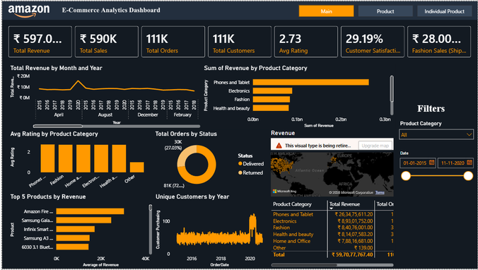
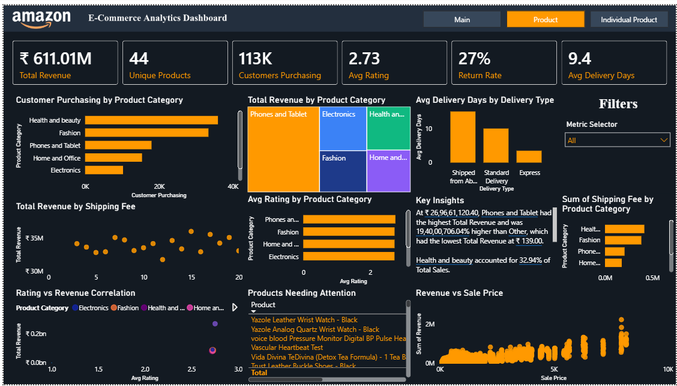
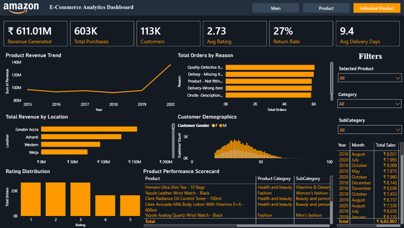

# Amazon E-Commerce Analytics Dashboard

An end-to-end Power BI analysis of Amazon e-commerce orders and customers from **2015–2020**. The report turns transactional data into an executive view of revenue, customers, product performance, returns, delivery experience, and regional opportunity.

> The interactive report is provided in `Dashboard.pbix`. Open it with Power BI Desktop; screenshots below are static previews of its three report pages.

## Dashboard preview

### 1. Main — executive revenue overview



This page is the leadership entry point. It combines revenue and order KPIs with monthly/annual trend analysis, category contribution, order-status mix, top-five products, customer acquisition, geographic revenue, and date/category filters.

### 2. Product — portfolio and operations



This page identifies the products and categories that drive revenue, surfaces products needing attention, and connects ratings, returns, shipping method, delivery time, and price to commercial performance.

### 3. Individual Product — drill-down view



Use the product, category, subcategory, year, and month selectors to diagnose an individual SKU. The page supports the drill-down from executive signals to product-level action.

## Key outcomes

| Area | Finding | Business implication |
| --- | --- | --- |
| Revenue | ₹61.1 Cr total revenue over 2015–2020; 2020 is the highest-revenue year at ₹10.1 Cr. | Plan stock and campaigns around the strongest annual demand period. |
| Seasonality | December 2019 posted the largest month-over-month growth (+540%). February is a persistently weaker month. | Repeat successful year-end campaigns and target February with focused promotions. |
| Product mix | Phones & Tablets contributes roughly 35% of revenue and is the leading category. | Prioritize availability and marketing for the category; cross-sell Electronics. |
| Customers | 113K customers; acquisition peaks at 22,305 in 2020. Ages 25–45 are the core segment. | Personalize acquisition and retention for the core demographic. |
| High value | 193 customers generate revenue above 130% of average customer revenue. | Create a Platinum / premium loyalty program and targeted retention offers. |
| Experience | Average rating is 2.73/5, return rate is about 27%, and delivered orders average 9.4 days. | Quality control, accurate product content, and faster fulfillment are the highest-impact improvement areas. |

## Report capabilities

- Three connected report pages: **Main**, **Product**, and **Individual Product**.
- KPI cards that respond to slicers and filters.
- Year, month, product category, subcategory, and selected-product filtering.
- Product-level drill-through for root-cause investigation.
- A dynamic metric selector to switch among business metrics without duplicating visuals.
- DAX time-intelligence comparisons for month-over-month and year-over-year review.
- Maps for location-level revenue analysis and tables/scorecards for product action lists.

## Data model and preparation

The report models a one-to-many relationship:

```text
Customers[CustomerID] (1) ───── (*) Orders[CustomerID]
```

The `Customers` table provides customer attributes such as age and gender, while `Orders` holds the transactional grain. Customer age can be surfaced on an order through:

```DAX
Customer Age = RELATED(Customers[Customer Age])
```

Power Query is used for repeatable preparation before loading to the model:

- Correct date, whole-number, decimal/currency, and text data types.
- Replace blank `Reason` values with `Not Applicable`.
- Remove duplicate `OrderID` records and records with critical missing values.
- Create derived columns including revenue, delivery days, age group, and a needs-improvement flag.

## Core measures

Representative measures used in the dashboard:

```DAX
Total Revenue =
SUMX(Orders, Orders[Sale Price] * Orders[Order Quantity])

Unique Products =
DISTINCTCOUNT(Orders[Product])

Returned Products =
CALCULATE(COUNT(Orders[OrderID]), Orders[Status] = "Returned")
```

The report also includes measures for total sales, total orders, total customers, average rating, return rate, customer satisfaction, and average delivery days. Delivery-time analysis is intentionally scoped to delivered orders.

## SQL analysis

[`Objective Query.sql`](Objective%20Query.sql) contains MySQL queries for the advanced analysis that informs the dashboard and recommendations:

1. Composite-score ranking of the top five customers: 50% revenue, 30% order frequency, 20% average order value.
2. Monthly revenue with a `LAG()`-based month-over-month growth calculation.
3. Rolling three-month category revenue using a windowed `AVG()`.
4. A conditional 15% discount update for customers with at least ten orders.
5. Average days between orders for repeat customers.
6. Customers exceeding 130% of average customer revenue.
7. Top three category-level year-over-year sales increases.

## Recommendations

1. **Reduce returns first.** Audit high-revenue products with return rates above 20%, improve pre-dispatch quality checks, and align descriptions, images, and specifications with the actual item.
2. **Build a high-value customer program.** Enroll the 193 high-value customers in a Platinum tier, then use personal recommendations and exclusive offers to convert one-time purchasers into repeat buyers.
3. **Plan seasonal campaigns.** Replicate successful December activity, place inventory ahead of expected peaks, and use a February promotion to counter the lower-revenue period.
4. **Protect delivery experience.** Shorten overseas fulfillment (approximately 15 days in the analysis) through local inventory/fulfillment options and use delivery type to monitor service-level gaps.
5. **Invest selectively in the assortment.** Maintain Phones & Tablets leadership, develop Electronics through cross-sell and promotions, and use the three-month rolling average to guide purchasing decisions.

## Repository contents

| File or folder | Purpose |
| --- | --- |
| `Dashboard.pbix` | Interactive Power BI report and data model. |
| `Objective Query.sql` | MySQL analysis queries (Q14–Q20). |
| `Tasks Amazon.docx` | Detailed assignment answers, methodology, and analytical findings. |
| `Amazon_ECommerce.pptx.pptx` | Presentation describing the project, results, and recommendations. |
| `docs/screenshots/` | Dashboard page screenshots used in this README. |

## How to run

1. Install [Power BI Desktop](https://powerbi.microsoft.com/desktop/).
2. Clone or download this repository.
3. Open `Dashboard.pbix` in Power BI Desktop.
4. If Power BI prompts for source credentials or a refresh, point the queries to the corresponding Orders and Customers sources, then select **Refresh**.
5. Use the page navigation and slicers to explore the report; select a product to view its dedicated drill-down page.

## Technology stack

- Power BI Desktop for modeling and interactive reporting
- Power Query (M) for ETL and data-quality transformations
- DAX for measures, calculated columns, and time intelligence
- MySQL for customer, revenue, rolling-average, and growth analyses

## Notes and limitations

- The supplied project files do not include the raw Orders and Customers data extracts, so refresh requires access to the original source locations.
- Dataset results show predominantly one order per customer. As a result, repeat-order discount and consecutive-order interval queries may return no qualifying records; this is a data characteristic, not a report error.
- Dashboard visuals are historical snapshots for the 2015–2020 analysis window. Refreshing with a different source or filter context will change the displayed values.
